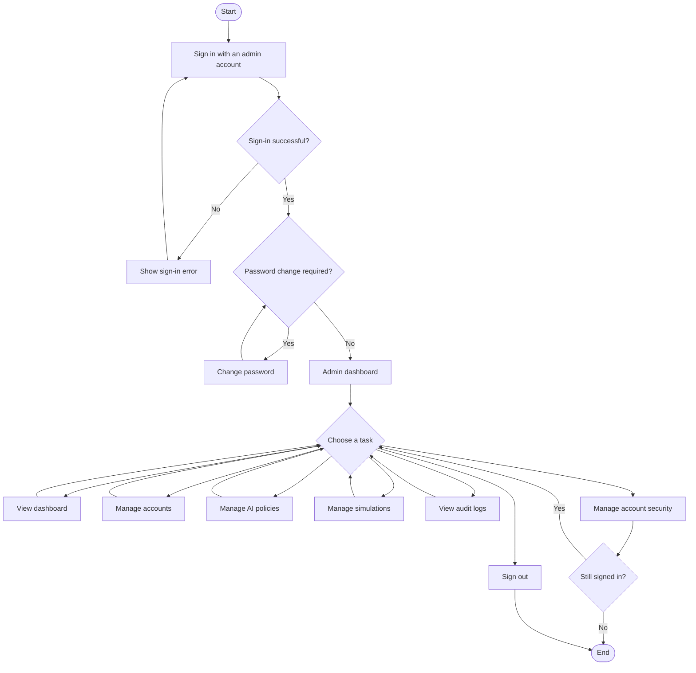

# Admin flowchart — HelpDesk AI

Sign in, choose a task, then continue working or sign out.

## Tasks

| Task | What the admin does |
| --- | --- |
| View dashboard | Check system activity and statistics. |
| Manage accounts | Create or update accounts, assign roles, reset passwords and manage access. |
| Manage AI policies | Update AI rules and messages, review policy events and manage session restrictions. |
| Manage simulations | Create, edit, test, enable, disable or delete modules. |
| View audit logs | Search and review recorded admin actions. |
| Manage account security | Change your password or sign out of all devices. |

## Notes

- This flow requires an active admin account.
- A required password change must succeed before proceeding.
- Failed actions show an error so the admin can correct or retry them.
- Returning to task selection is a navigation choice.
- End an active Windows simulation test before leaving it.
- Signing out of all devices ends the current session.

Related: [Role use cases](GENERALIZED_USE_CASES.md) and [User flowchart](USER_FLOWCHART.md).
