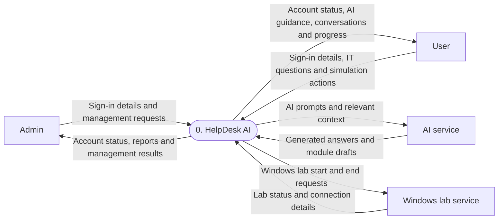
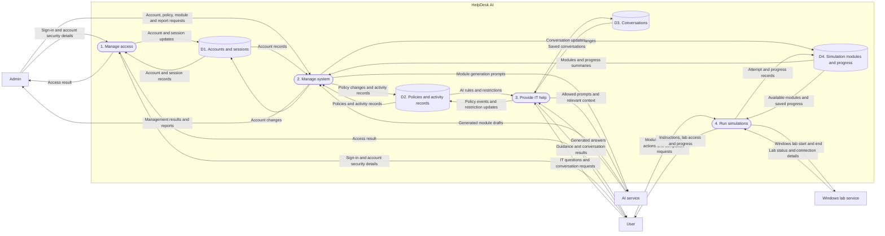

# Data flow diagram — HelpDesk AI

These diagrams show what data enters the system, where it is processed and where it is stored.

## Context diagram

The whole system is shown as one process.

## Level 1 diagram

The system is divided into four main processes.

## Data stores

| Store | Data kept |
| --- | --- |
| D1. Accounts and sessions | Account details, password hashes, roles and sign-in sessions. |
| D2. Policies and activity records | AI rules, restrictions, policy events and admin audit records. |
| D3. Conversations | Personal chat history and conversation state. |
| D4. Simulation modules and progress | Module definitions, drafts, attempts and completion records. |

## Notes

- Rectangles are external actors or services, rounded shapes are processes, and cylinders are data stores.
- Arrow labels name the data being exchanged; they do not show the order of steps.
- Stores are logical groups, not individual database tables.
- Admin processes require admin access. Users access only their own conversations and progress.
- AI answers are checked against system policies before being shown.
- The Windows lab service represents AWS provisioning and Guacamole access. Terminal simulations run within the system.
- Terminal completion uses verified simulated steps. Windows completion is self-reported.

Related: [Role use cases](GENERALIZED_USE_CASES.md), [Admin flowchart](ADMIN_FLOWCHART.md) and [User flowchart](USER_FLOWCHART.md).
