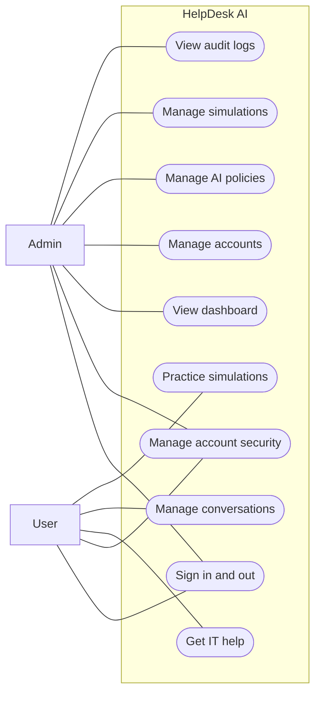

# Use cases — HelpDesk AI

Admin manages the system. User gets IT help and practices IT tasks.

## Both roles

| ID | Use case | Description |
| --- | --- | --- |
| UC-01 | Sign in and out | Access the workspace assigned to the account's role. |
| UC-02 | Manage account security | Change your password or sign out of all devices. |

## Admin

| ID | Use case | Description |
| --- | --- | --- |
| AD-01 | View dashboard | Check system activity and statistics. |
| AD-02 | Manage accounts | Create, update, activate, deactivate or delete accounts, assign roles and reset passwords. |
| AD-03 | Manage AI policies | Update AI rules and messages, review policy events and manage session restrictions. |
| AD-04 | Manage simulations | Create, edit, test, enable, disable or delete simulation modules. |
| AD-05 | View audit logs | Search and review recorded admin actions. |

## User

| ID | Use case | Description |
| --- | --- | --- |
| US-01 | Get IT help | Ask the AI about an IT problem and ask follow-up questions. |
| US-02 | Manage conversations | Start, reopen, search, favorite or delete your conversations. |
| US-03 | Practice simulations | Choose a module, follow the tasks, and complete or end the simulation. |

## Use-case diagram

## Key rules

- Admins create accounts; public sign-up is unavailable.
- Each role has its own workspace. Users manage only their own conversations and account security.
- Complete a required password change before using protected features.
- AI assistance follows the system's IT scope and safety rules.
- Terminal completion uses verified simulated steps. Windows completion is self-reported.

Related: [Admin flowchart](ADMIN_FLOWCHART.md), [User flowchart](USER_FLOWCHART.md) and [PlantUML diagram](GENERALIZED_USE_CASES.puml).
