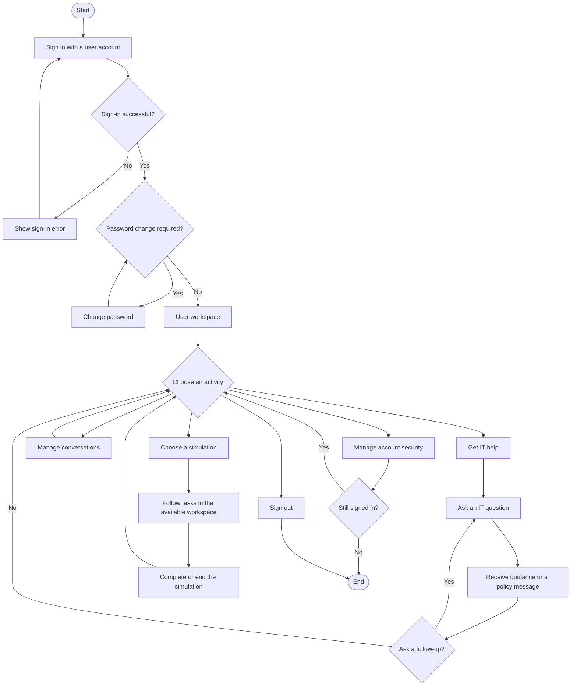

# User flowchart — HelpDesk AI

Sign in, get IT help or practice tasks, then sign out when finished.

## Activities

| Activity | What the user does |
| --- | --- |
| Get IT help | Describe an IT problem and ask follow-up questions. |
| Manage conversations | Start, reopen, search, favorite or delete your conversations. |
| Practice simulations | Choose a module, follow its tasks, and complete or end the simulation. |
| Manage account security | Change your password or sign out of all devices. |

## Notes

- Use an active account provided by an admin.
- A required password change must succeed before proceeding.
- AI assistance follows IT scope and safety rules.
- If a simulation is unavailable, retry or choose another activity. Rejected completion requires correction before it can be recorded.
- Terminal completion uses verified simulated steps. Windows completion is self-reported.
- Returning to activity selection is a navigation choice. End an active simulation before leaving it.
- Signing out of all devices ends the current session.

Related: [Role use cases](GENERALIZED_USE_CASES.md) and [Admin flowchart](ADMIN_FLOWCHART.md).
